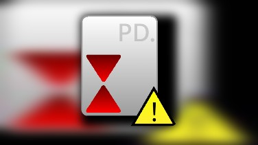

# Gh-groxhacker

Verwenden Sie die Browser-Version von TurboWarp, um Erweiterungen zu löschen, und verhindern Sie so, dass das Netzwerk automatisch wiederhergestellt wird.
Befolgen Sie nach dem Herunterladen von „COLID Rückschlag“ unbedingt die Anweisungen in der Datei „README“ im Archiv.
